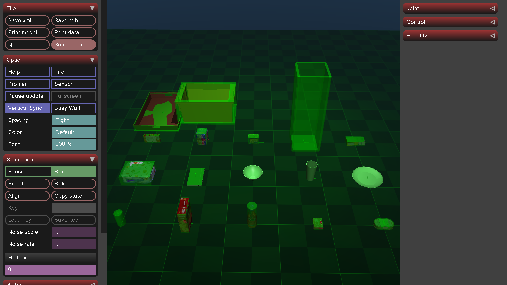

# prl_assets

Reusable manipulation objects (cans, bins, tableware, containers) for MuJoCo simulation.



This package provides simulation models and metadata for common manipulation objects like cans, bottles, tableware, and containers. Objects follow the `asset_manager` metadata format for compatibility with perception and planning pipelines.

## Installation

```bash
uv add prl_assets
```

For development:
```bash
git clone https://github.com/personalrobotics/prl_assets.git
cd prl_assets
uv sync --dev
```

## Quick Start

Use with `asset_manager` to load objects:

```python
from asset_manager import AssetManager
from prl_assets import OBJECTS_DIR

# Initialize asset manager with prl_assets objects
assets = AssetManager(OBJECTS_DIR)

# List available objects
print(assets.list())
# ['can', 'cracker_box', 'fuze_bottle', 'gelatin_box', 'herring_tin',
#  'lunchbox', 'notebook', 'plastic_bowl', 'plastic_glass', 'plastic_plate',
#  'pocky_box', 'pop_tarts_case', 'spam_can', 'recycle_bin', 'sugar_box',
#  'wicker_tray', 'yellow_tote']

# Get path to simulation model
can_path = assets.get_path("can", "mujoco")

# Load in MuJoCo
import mujoco

model = mujoco.MjModel.from_xml_path(can_path)

# Get object metadata
meta = assets.get("can")
print(meta["dimensions"])  # [0.066, 0.066, 0.123]
print(meta["mass"])  # 0.05 kg

# Find objects by category
containers = assets.by_category("container")
```

## YCB-Video Collection

`objects/ycbv/` holds objects from the YCB-Video (BOP `ycbv`) set, so that a pose
estimator trained on YCB-V and the simulator refer to the same object, geometry and
frame. Load the collection alone, or the whole catalog, which includes it:

```python
from asset_manager import AssetManager
from prl_assets import OBJECTS_DIR, YCBV_OBJECTS_DIR

ycbv = AssetManager(YCBV_OBJECTS_DIR)  # only the YCB-V objects
catalog = AssetManager(OBJECTS_DIR)  # everything, YCB-V included

catalog.resolve_alias("003_cracker_box")  # 'cracker_box'
catalog.get("cracker_box")["dataset"]["ycbv"]["bop_id"]  # 2
```

Each YCB-V object records its BOP id, its original YCB name (also a perception alias),
the rigid transform `T_asset_bop` from the BOP model frame (converted to metres) to the
asset frame, the BOP symmetries, and its provenance. To place a detected object:
`T_camera_asset = T_camera_bop @ inverse(T_asset_bop)`, with the detector's translation
in metres. [docs/schema.md](docs/schema.md) defines these fields and frames;
[docs/ycbv_audit.md](docs/ycbv_audit.md) records how the existing objects were matched
to the BOP models. The scans are CC BY 4.0, not MIT; see
[objects/ycbv/NOTICE.md](src/prl_assets/objects/ycbv/NOTICE.md).

The collection contains all 21 benchmark identities. `ycb_bowl` is distinct from the
existing `plastic_bowl`; `wood_block` is the benchmark block, not a generic toy cube.
Scissors, clamps and the foam brick represent the fixed, rigid benchmark configuration.
The benchmark pitcher scan is capped across the top, so it does not provide a usable
open interior. The mug and bowl retain their open interiors. The [full catalog source audit](docs/ycbv_catalog.json)
records geometry, texture and frame agreement for all 21 objects.

| BOP ID | Canonical name | Collision model |
| --- | --- | --- |
| 1 | `master_chef_can` | convex envelope |
| 2 | `cracker_box` | retained box |
| 3 | `sugar_box` | retained box |
| 4 | `tomato_soup_can` | convex envelope |
| 5 | `mustard_bottle` | convex decomposition |
| 6 | `tuna_fish_can` | convex envelope |
| 7 | `pudding_box` | convex envelope |
| 8 | `gelatin_box` | retained box |
| 9 | `spam_can` | retained box |
| 10 | `banana` | convex decomposition |
| 11 | `pitcher_base` | convex decomposition, capped benchmark scan |
| 12 | `bleach_cleanser` | convex decomposition |
| 13 | `ycb_bowl` | convex decomposition, open interior |
| 14 | `mug` | convex decomposition, open interior |
| 15 | `power_drill` | convex decomposition |
| 16 | `wood_block` | convex envelope |
| 17 | `scissors` | convex decomposition |
| 18 | `large_marker` | convex envelope |
| 19 | `large_clamp` | convex decomposition |
| 20 | `extra_large_clamp` | convex decomposition |
| 21 | `foam_brick` | convex envelope |

### Migrating from flat paths

`cracker_box`, `sugar_box`, `gelatin_box` and `spam_can` moved from `objects/<name>/`
to `objects/ycbv/<name>/`. Their names, aliases, models and physical properties did not
change, so code that looks them up through `AssetManager` is unaffected. Code that
builds paths such as `OBJECTS_DIR / "cracker_box"` must use
`AssetManager(OBJECTS_DIR).get_path("cracker_box", "mujoco")` instead.

## Available Objects

| Object | Description | Collision |
|--------|-------------|-----------|
| `can` | Aluminum soda/beer can | cylinder |
| `cracker_box` | Cheez-It crackers box (YCB-V 2) | box |
| `fuze_bottle` | Beverage bottle with texture | 11 stacked cylinders (body, shoulder, neck) |
| `gelatin_box` | Jell-O gelatin box (YCB-V 8) | box |
| `herring_tin` | MW Polar herring tin | box + 2 cylinders |
| `lunchbox` | Wildkin insulated lunch box | convex hull of the scan |
| `notebook` | Amazon Basics hardcover notebook | box |
| `plastic_bowl` | Tableware bowl (nestable) | open shell, 145 boxes |
| `plastic_glass` | Drinking glass (open) | open shell, 97 boxes |
| `plastic_plate` | Dinner plate (stackable) | open shell, 113 boxes |
| `pocky_box` | Pocky biscuit sticks box | box |
| `pop_tarts_case` | Pop-Tarts food box | box |
| `spam_can` | SPAM canned meat (YCB-V 9, potted meat can) | box |
| `recycle_bin` | Open-top recycling bin (hollow) | 5 boxes |
| `sugar_box` | Domino sugar box (YCB-V 3) | box |
| `wicker_tray` | Serving tray (hollow) | floor + 4 tapered walls |
| `yellow_tote` | Storage tote (hollow) | floor + 4 tapered walls + rim lip |

## Object Structure

Each object follows a standardized directory structure. Objects may be grouped in a
collection directory, such as `ycbv/`, which has no `meta.yaml` of its own:

```
objects/
├── object_name/
│   ├── meta.yaml          # Object metadata
│   ├── object_name.xml    # MuJoCo model
│   └── *_visual.obj       # Visual mesh (optional)
└── ycbv/
    └── cracker_box/       # same structure, plus YCB-V metadata
```

### Metadata Format

The `meta.yaml` file contains all object properties:

```yaml
name: can
description: Standard aluminum soda/beer can
category: [container, recyclable, graspable]

# Physical properties
mass: 0.05  # kg
dimensions: [0.066, 0.066, 0.123]  # meters [X, Y, Z] in resting pose; Z = height
material: aluminum

# Geometric properties for grasp planning
geometric_properties:
  type: cylinder
  radius: 0.033
  height: 0.123

# Simulator-specific configuration
mujoco:
  xml_path: can.xml
  scale: 1.0
  friction: [0.6, 0.005, 0.0001]

# Perception aliases for detection systems
perception:
  aliases: ["can", "soda can", "beer can"]

# Manipulation policy hints
policy:
  grasping:
    affordances: [lift, pour]
    preferred_grasp_type: side_grasp
    difficulty: easy
```

## Adding New Objects

`prl_assets.authoring` measures a model as MuJoCo compiles it and builds collision
geometry from the visual mesh. CI runs the same check on every object
(`tests/test_collision_fit.py`), so an object that passes here passes there. Install it
with the `authoring` extra (`uv sync --extra authoring`).

1. Create `src/prl_assets/objects/<name>/` with the visual mesh and any texture.
2. Write a `meta.yaml` and a first model with a placeholder collision geom, so the
   visual mesh can be measured as MuJoCo loads it.
3. Build collision geometry from the visual mesh with the builder that matches the
   object's shape:

   | Shape | Builder |
   | --- | --- |
   | Box-like | `fit_box` |
   | Solid of revolution (can, bottle) | `stacked_cylinders` |
   | Open container of revolution (cup, bowl, plate) | `fit_revolved_shell`, and declare `geometric_properties.open: true` |
   | Open box (tote, tray, bin) | `tapered_open_box` or `open_box`, and declare `open: true` |
   | Convex without a cavity, faces that bulge (a soft bag) | `hull_of` |

4. Run `uv run --extra authoring python scripts/validate_objects.py <name>` until it
   passes, and look at the result with `scripts/inspect_object.py <name>`. Where a
   primitive deliberately departs from the scan, such as a box with flat faces for a
   scan with rounded edges, declare the tolerance and the reason (see
   [docs/schema.md](docs/schema.md#collision-geometry)).
5. Add the object to the table above.

For a cup, steps 2 to 4 look like this:

```python
from pathlib import Path

from prl_assets import authoring

cup = Path("src/prl_assets/objects/paper_cup")
placeholder = authoring.GeomSpec("box", [0.01, 0.01, 0.01], [0.0, 0.0, 0.0])
authoring.write_model(cup, "paper_cup", "paper_cup_visual.obj", [placeholder], mass=0.01)
authoring.write_meta(
    cup,
    "paper_cup",
    description="Paper cup",
    category=["container", "graspable"],
    mass=0.01,
    geometric_properties={"type": "cylinder", "open": True},
)

obj = authoring.load(cup)
points = authoring.to_body(obj, authoring.visual_points(obj))
floor = authoring.visual_floor(obj) - obj.data.xpos[obj.body][2]
authoring.replace_collision_geoms(
    cup / "paper_cup.xml",
    "paper_cup",
    authoring.fit_revolved_shell(points, floor),
    mass=0.01,
    body_pos=(0.0, 0.0, -points[:, 2].min()),  # rest the file's pose on z = 0
    comment="Collision geometry: open cup from authoring.fit_revolved_shell",
)
print(authoring.check(cup))
```

### MuJoCo Model Requirements

Objects used with `mj_environment` must follow these conventions:

```xml
<mujoco model="object_name">
  <worldbody>
    <body name="object_name" pos="0 0 {half_height}">
      <freejoint name="object_name_joint"/>  <!-- Required for positioning -->
      <!-- geoms, sites, etc. -->
    </body>
  </worldbody>
</mujoco>
```

- **freejoint**: Required for `registry.activate()` to set object position/orientation
- **body name**: Should match the object type (becomes `{type}_{index}` when loaded)

### Coordinate Frame Standard

All objects must follow this coordinate frame convention:

1. **Origin at bottom center**: The body origin is at the center of the object's base (bottom surface) in its canonical resting pose
2. **Z-up orientation**: The object's primary axis is aligned with +Z
3. **Rests on z=0**: When placed at position (x, y, 0), the object sits on a z=0 surface
4. **Canonical resting pose**: The stable pose the object would naturally rest in (e.g., can upright, box on largest face)
5. **Dimensions in resting frame**: The `dimensions` field in meta.yaml is [X, Y, Z] in the canonical resting pose, where **Z is always the height when resting**. For a flat object (e.g., herring tin) that rests on its largest face, Z is the thin dimension.

**Implementation**: The body `pos` places the object so that the bottom of its collision geometry is at z=0; for geometry centred on the body origin, that is half the object's height (dimensions[2]/2):
```xml
<!-- For a cylinder of height 0.123m -->
<body name="can" pos="0 0 0.0615">
```

**Collision and visual alignment**: Collision geometry must have the shape of the visual mesh, within the tolerances in [docs/schema.md](docs/schema.md#collision-geometry); `scripts/validate_objects.py` measures it.

**YCB-V objects**: the body `pos` is only the placement that rests the object on z=0
when its file is loaded alone; it does not change the object's frame. A YCB-V object's
geometry is expressed about the BOP model origin, near its geometric centre, and the
relation to the BOP frame is `T_asset_bop`. See [docs/schema.md](docs/schema.md#frames-framest_asset_bop).

**Verification**: Run visualization scripts to verify object geometry:

```bash
# Inspect a single object with collision overlay
uv run python scripts/inspect_object.py can

# Visualize all objects in a grid
uv run python scripts/viz_all_objects.py

# Physics demo with stacking
uv run python scripts/viz_stacking_demo.py

# Check every object the way CI does
uv run --extra authoring python scripts/validate_objects.py
```

## Scripts

| Script | Description |
|--------|-------------|
| `inspect_object.py` | Visualize single object with collision overlay and coordinate axes |
| `viz_all_objects.py` | Display movable catalog objects in a grid with collision geometry |
| `viz_stacking_demo.py` | Physics demo: stacked dishes on tray, objects in tote |
| `validate_objects.py` | Check objects the way CI does: conventions, mass, collision geometry against the visual mesh, open interiors |
| `recenter_mesh.py` | Utility to re-center mesh origin to centroid |
| `audit_ycbv.py` | Check YCB-V objects' declared frames against the pinned BOP models by shape and texture; writes `artifacts/ycbv_audit.json`, and with `--record` `docs/ycbv_audit.json` |

## License

The code is MIT licensed; see LICENSE. Object data keeps its source's terms: the YCB-V
scans are CC BY 4.0, as stated in
[objects/ycbv/NOTICE.md](src/prl_assets/objects/ycbv/NOTICE.md).

## Importing YCB-V objects

The importer requires the optional `ycbv` dependencies:

```bash
uv sync --extra ycbv --extra dev
uv run python -m prl_assets.import_ycbv \
  --objects cracker_box mustard_bottle \
  --output src/prl_assets/objects/ycbv
```

It verifies and caches the pinned 525 MB BOP model archive before reading models.
Use `--archive /path/to/ycbv_models.zip` to reuse an existing copy. Recipes cover
the 17 new objects; the four audited overlaps are retained without modifying their
geometry, frames, aliases, or physical properties. Start with a copy of the packaged
collection when reproducing the complete set, so the four retained models are present.

New objects are converted and validated without discoverable metadata, then
published with `meta.yaml` last. Existing directories are never overwritten.
The JSON report (`artifacts/ycbv_import.json`, configurable with `--report`) records
source and output hashes, conversion settings, and collision measurements.

The imported visual mesh is the original BOP geometry converted to metres, with
UVs preserved and the texture resized to 1024 by 1024. Convex collision pieces are
created with pinned CoACD settings for concave objects; closed convex objects use
the visual mesh’s convex envelope. Mass comes from the cited YCB reference object;
inertia and friction are estimates, not measured properties of a lab copy.
`geometric_properties.type: box` describes an axis-aligned grasp envelope; it does
not replace the actual compound collision geometry or certify a grasp policy.
Detailed decompositions favor geometry over contact speed (the pitcher has 567 pieces);
benchmark the intended scene before scaling up simulation. The tuna can uses a 4 ms
contact time constant to prevent tunneling through the bin at the documented drop speed.

The independent real-archive integration check is run once in the cached audit job:

```bash
PRL_ASSETS_YCBV_ARCHIVE="$HOME/.cache/prl_assets/ycbv_models.zip" \
  uv run --extra ycbv --extra dev pytest tests/test_ycbv_import.py -q
```

It retains the existing cracker box, imports the mustard bottle, checks its frame
and texture against the source with the independent audit, verifies every reported
output hash, and confirms invalid requests leave all assets unchanged. Inspect
`artifacts/ycbv_import_validation.json`; no dataset download occurs in the default
test suite.
